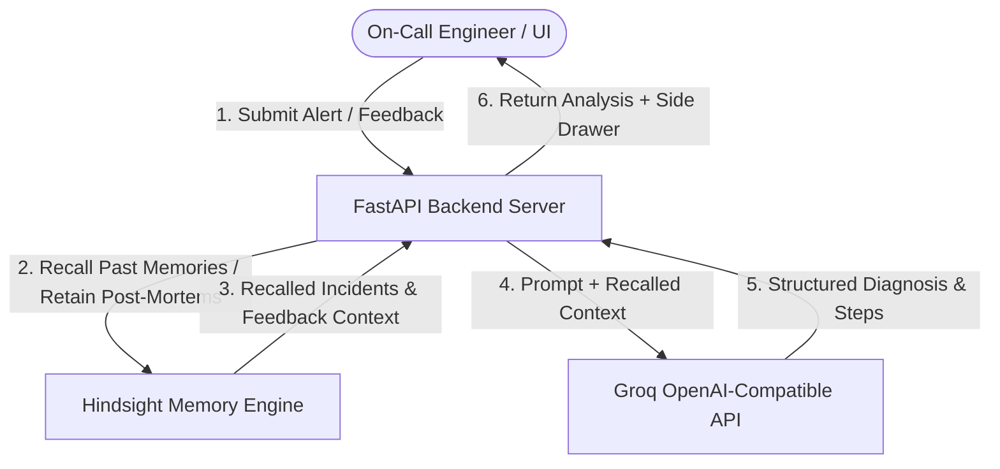

# OnCallMemory: Incident-Response AI Agent with Persistent Hindsight Memory

**OnCallMemory** is an AI-powered incident-response copilot built with **FastAPI**, **Hindsight**, and **Groq LLM**. It leverages persistent memory to store past incident post-mortems and engineer feedback, empowering on-call engineers with context-aware root cause diagnoses and proven remediation steps.

---

## System Architecture



---

## How Hindsight Memory is Used

Hindsight serves as the persistent long-term memory engine for OnCallMemory. It enables memory banks scoped per team (e.g. `acme-platform-team`) using `hindsight-client`:

1. **`client.retain(bank_id, content, context, timestamp)`**:
   - **Incident Post-Mortems**: Every past incident (including service name, symptoms, error logs, metrics, root cause, fix, and time-to-resolve) is retained in the team's bank.
   - **Resolution Feedback**: Whenever an engineer marks a suggested remediation step as *worked* or *didn't work*, the outcome is retained in Hindsight. Over time, future recalls prioritize solutions that proved successful in production.
2. **`client.recall(bank_id, query)`**:
   - When a new incident alert arrives, OnCallMemory performs a semantic and keyword recall against Hindsight to fetch top matching past incidents and historical feedback notes.
   - Recalled memories are injected directly into the LLM prompt when Memory mode is **ON**.
3. **`client.reflect(bank_id, query)`**:
   - For systemic health analysis (`GET /patterns`), `client.reflect` synthesizes patterns across all stored post-mortems to surface recurring architectural failure modes (e.g., connection pool exhaustion across services, unthrottled batch queries, memory leaks).

---

## Features & Highlights

- **FastAPI + Python 3.12 Backend**: Asynchronous REST endpoints for seeding (`POST /seed`), diagnosing (`POST /incident`), feedback logging (`POST /feedback`), and pattern synthesis (`GET /patterns`).
- **Groq LLM Integration**: Uses OpenAI-compatible API (`openai/gpt-oss-120b` with fallback to `qwen/qwen3-32b`) wrapped with retries and graceful fallback handling.
- **Single-Page UI**: Interactive Bootstrap dashboard supporting alert presets, Memory ON/OFF toggle, side-by-side comparison mode, feedback loop logging, and recurring pattern synthesis.
- **15 Realistic Seed Incidents**: Comprehensive seed data set in `data/incidents.json` featuring real-sounding stack traces, DB pool failures, OOM kills, NAT port exhaustion, and Redis memory issues.

---

## Quickstart Guide

### 1. Installation & Environment Setup

Copy `.env.example` to `.env` and fill in your API keys:

```bash
cp .env.example .env
```

`.env` configuration parameters:
```ini
HINDSIGHT_BASE_URL=http://localhost:8080
HINDSIGHT_API_KEY=your_hindsight_key
GROQ_API_KEY=your_groq_api_key
HINDSIGHT_BANK_ID=acme-platform-team
```

Install Python dependencies:

```bash
pip install -r requirements.txt
# or
pip install hindsight-client fastapi uvicorn openai python-dotenv pydantic pytest
```

### 2. Running the Server

Start the FastAPI application:

```bash
uvicorn app.main:app --host 0.0.0.0 --port 8000 --reload
```

Open your browser at `http://localhost:8000` to access the single-page web UI.

---

## API Endpoints Summary

- `POST /seed`: Load `data/incidents.json` into Hindsight via `retain()`.
- `POST /incident`: Analyze `{ alert_text, memory: bool }`. Returns `{ diagnosis, suggested_steps, recalled_memories }`.
- `POST /feedback`: Log outcome `{ incident_id, suggestion, worked: bool, notes }` into Hindsight.
- `GET /patterns`: Call `reflect()` to retrieve recurring architectural failure patterns.
