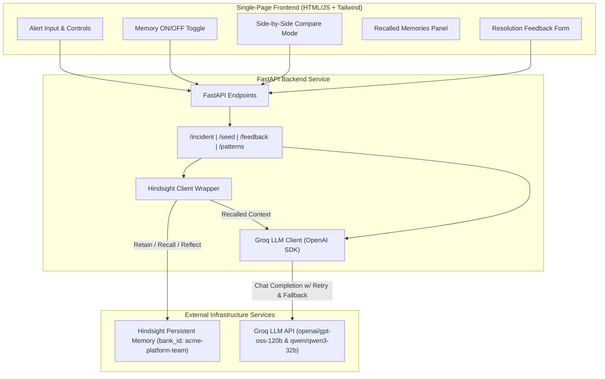

# OnCallMemory: Incident-Response AI Agent

**OnCallMemory** is an intelligent, memory-augmented SRE incident-response AI agent designed to streamline on-call diagnosis, post-mortem analysis, and remediation workflows. Powered by **Hindsight** for persistent memory retention and recall, OnCallMemory ensures past outage lessons, root causes, and fix feedback directly inform future incident triage.

---

## Architecture Diagram



---

## Features

- **Persistent Memory Integration**: Retains past incident post-mortems and feedback outcomes in team-specific Hindsight banks (e.g. `acme-platform-team`).
- **Context-Aware Triage (`POST /incident`)**:
  - **Memory Enabled (`memory: true`)**: Recalls semantically similar historical outages and feedback outcomes to enrich the LLM prompt with actual organizational knowledge.
  - **Memory Disabled (`memory: false`)**: Standard zero-context LLM diagnosis.
- **Side-by-Side Compare Mode**: Visually compare diagnostic quality and suggested resolution accuracy with and without Hindsight memory.
- **Feedback & Outcome Retention (`POST /feedback`)**: Record whether a suggested fix worked or failed, allowing Hindsight to steer future AI recommendations towards verified solutions.
- **Pattern Reflection (`GET /patterns`)**: Leverages `hindsight.reflect()` to discover recurring incident trends across all team services.
- **Resilient LLM Execution**: Built on Groq's OpenAI-compatible endpoint with exponential backoff retry logic and automatic model fallback (`openai/gpt-oss-120b` &rarr; `qwen/qwen3-32b`).

---

## How Hindsight Memory is Used

OnCallMemory relies on three core primitives provided by the `hindsight-client` Python SDK:

1. **`client.retain(bank_id, content, context, timestamp)`**:
   - **Post-Mortem Retention (`POST /seed`)**: Whenever past incidents are ingested, OnCallMemory stores structured details including service name, alert symptoms, error log stack trace, metrics, root cause, verified fix, and resolution time into the team's Hindsight bank (`acme-platform-team`).
   - **Feedback Outcome Retention (`POST /feedback`)**: SRE feedback on whether a proposed remediation step resolved the outage is stored into Hindsight. This creates a feedback loop where successful fixes are reinforced in future searches.

2. **`client.recall(bank_id, query)`**:
   - When a new alert is received via `POST /incident` with `memory=true`, OnCallMemory queries Hindsight using `client.recall()`.
   - Hindsight returns the most relevant past post-mortems and feedback notes. These recalled memories are injected directly into the LLM system/user context, giving the AI model specific historical precedent to reference.

3. **`client.reflect(bank_id, query)`**:
   - Accessed via `GET /patterns` and the "View Recurring Patterns" modal in the UI.
   - Executes `client.reflect()` to synthesize higher-level insights across all stored memories, identifying systemic issues (such as repeated database connection pool exhaustions across different microservices).

---

## Getting Started

### Prerequisites
- Python 3.10+
- Hindsight server instance (or Hindsight Cloud)
- Groq API key

### Configuration
Create a `.env` file in the root directory (refer to `.env.example`):
```env
HINDSIGHT_BASE_URL=http://localhost:8080
HINDSIGHT_API_KEY=your_hindsight_api_key
GROQ_API_KEY=your_groq_api_key
HINDSIGHT_BANK_ID=acme-platform-team
```

### Installation
```bash
pip install -r requirements.txt
# or install directly:
pip install hindsight-client fastapi uvicorn openai python-dotenv pytest httpx
```

### Running the Service
Start the FastAPI server:
```bash
uvicorn app.main:app --host 0.0.0.0 --port 8000 --reload
```

Access the frontend UI in your browser at `http://localhost:8000/`.

---

## API Endpoints Summary

| Method | Endpoint | Description |
| :--- | :--- | :--- |
| `POST` | `/seed` | Retains all 15 sample post-mortems in `data/incidents.json` into Hindsight |
| `POST` | `/incident` | Accepts `{alert_text, memory: bool}` and returns diagnosis, suggested steps, and recalled memories |
| `POST` | `/feedback` | Accepts `{incident_id, suggestion, worked: bool, notes}` and retains the feedback outcome |
| `GET` | `/patterns` | Invokes Hindsight reflection to return recurring incident patterns |
| `GET` | `/` | Serves the single-page web UI |
